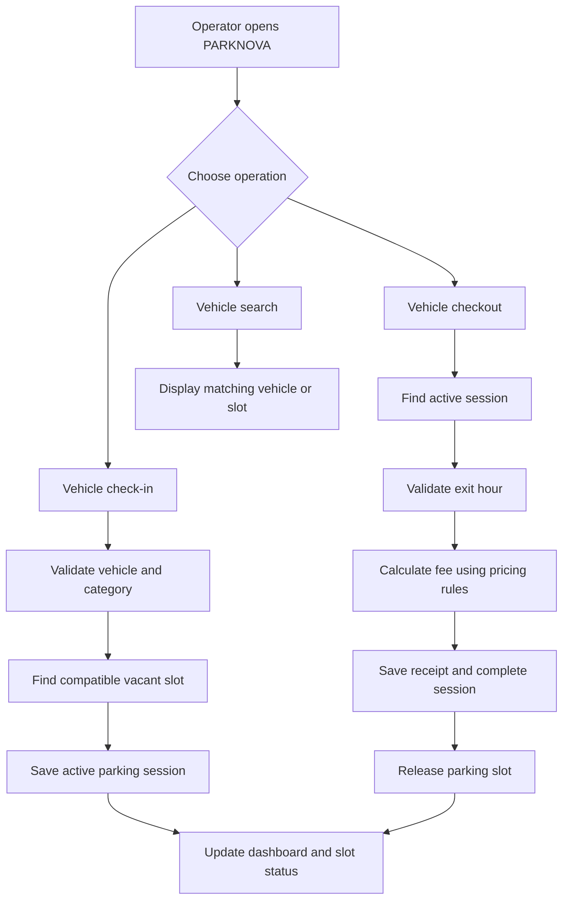

::: {align="center"}
# 🚗 PARKNOVA

### Smart Campus Parking & Vehicle Intelligence System

**Every Slot. Every Vehicle. Under Control.**

A modern campus parking management system designed to simplify vehicle
entry, slot allocation, checkout, fee calculation, and live occupancy
monitoring.


:::

------------------------------------------------------------------------

## 🌌 Project Preview

> **Add your actual application screenshots here after running the
> project.** Save them inside `docs/images/` and use the suggested
> filenames below. Do not use mock screenshots as evidence of working
> features.

  Live Dashboard                Parking Slot Grid
  ----------------------------- --------------------------------
  `docs/images/dashboard.png`   `docs/images/parking-grid.png`

Once the images are added to your repository, replace this table with:

``` md


```

  Vehicle Check-in             Digital Receipt
  ---------------------------- ---------------------------
  `docs/images/check-in.png`   `docs/images/receipt.png`

``` md


```

## ✨ Why PARKNOVA?

Traditional paper-based parking registers can make it difficult to find
vacant spaces, locate parked vehicles, calculate fees consistently, and
track daily collections.

PARKNOVA aims to bring these operations into one clear, easy-to-use
interface.

-   🅿️ **Visual parking grid** --- view available and occupied slots.
-   🚘 **Vehicle check-in** --- allocate a compatible vacant slot.
-   🔎 **Vehicle finder** --- search by registration number or slot ID.
-   🧾 **Transparent checkout receipts** --- display duration and fee
    breakdown.
-   📊 **Live operational dashboard** --- show occupancy, availability,
    and daily totals from stored records.
-   🛡️ **Input validation** --- prevent duplicate active registrations
    and invalid checkout times.
-   💾 **Persistent records** --- retain parking sessions after
    application restarts.
-   📈 **Parking insights** --- summarize occupancy and revenue using
    actual records.
-   🧪 **Demo and testing workflow** --- make the project easier to
    demonstrate and verify.

> Features should be marked as complete only after they have been
> implemented and tested in the actual codebase.

## 🧭 How It Works



## 🅿️ Parking Capacity

PARKNOVA is designed around the capacity defined in the Codethon problem
statement.

  Zone            Slot IDs         Capacity
  --------------- -------------- ----------
  Two-wheelers    T-01 to T-10           10
  Four-wheelers   F-01 to F-05            5
  **Total**       **15 slots**       **15**

All slots should begin as available on a fresh database. Existing
occupancy should be restored from persistent storage after a restart.

## 💰 Fee Structure

The following rates are based on the supplied problem statement.

  -----------------------------------------------------------------------
  Owner category          Two-wheeler             Four-wheeler
  ----------------------- ----------------------- -----------------------
  Staff                   Free (₹0)               Free (₹0)

  Student                 First 2 hours free,     First 2 hours free,
                          then ₹10/hour           then ₹20/hour

  Visitor                 ₹20/hour (flat rate)    ₹40/hour (flat rate)
  -----------------------------------------------------------------------

### Example receipt calculation

A student parks a two-wheeler from **09:00 to 13:00**:

-   Total duration: 4 hours
-   First 2 hours: free
-   Chargeable duration: 2 hours
-   Rate: ₹10 per chargeable hour
-   **Total due: ₹20**

The system must reject an exit hour earlier than the entry hour. The
supplied specification uses whole-hour inputs from 0--23, so overnight
parking is not represented by this basic time model.

## 🧰 Technology Stack

The proposed implementation uses:

-   **Python** --- application logic and fee calculation
-   **Flask** --- web application and routes
-   **HTML5 / CSS3** --- page structure and styling
-   **JavaScript** --- client-side interactions
-   **SQLite** --- persistent application data
-   **Git & GitHub** --- version control and collaboration

Adjust this section if the final implementation uses a different stack.

## 🗂️ Suggested Project Structure

``` text
PARKNOVA/
├── app.py
├── requirements.txt
├── README.md
├── database/
│   └── schema.sql
├── services/
│   ├── parking_service.py
│   ├── billing_service.py
│   └── validation.py
├── templates/
│   ├── base.html
│   ├── dashboard.html
│   ├── checkin.html
│   ├── checkout.html
│   └── vehicle_search.html
├── static/
│   ├── css/
│   │   └── style.css
│   ├── js/
│   │   └── app.js
│   └── images/
├── tests/
│   ├── test_billing.py
│   └── test_parking.py
└── docs/
    └── images/
        ├── dashboard.png
        ├── parking-grid.png
        ├── check-in.png
        └── receipt.png
```

This is a suggested structure; keep the README aligned with the files
actually present in the repository.

## ⚙️ Getting Started

### 1. Clone the repository

``` bash
git clone https://github.com/YOUR-USERNAME/PARKNOVA.git
cd PARKNOVA
```

Replace `YOUR-USERNAME` with your GitHub username and `PARKNOVA` with
your repository name if different.

### 2. Create a virtual environment

**Windows**

``` bash
py -m venv .venv
.venv\Scripts\activate
```

**macOS / Linux**

``` bash
python3 -m venv .venv
source .venv/bin/activate
```

### 3. Install dependencies

``` bash
pip install -r requirements.txt
```

### 4. Start the application

Use the command documented by the actual project. For a standard Flask
entry point named `app.py`, this may be:

``` bash
python app.py
```

Then open the local URL printed by the application in your browser. Do
not assume a port or command if the implementation specifies something
different.

## 🧪 Validation Checklist

Before presenting PARKNOVA, verify the following cases against the real
application:

-   [ ] Initializes 10 two-wheeler and 5 four-wheeler slots.
-   [ ] Allocates a slot only from the compatible zone.
-   [ ] Rejects a duplicate active vehicle registration.
-   [ ] Prevents allocation when the relevant zone is full.
-   [ ] Calculates staff parking as ₹0.
-   [ ] Calculates student charges correctly at 1, 2, 3, and 4 hours.
-   [ ] Calculates visitor charges using the correct flat hourly rate.
-   [ ] Rejects invalid hours and exit times earlier than entry times.
-   [ ] Generates a receipt with a transparent fee breakdown.
-   [ ] Releases the slot after a successful checkout.
-   [ ] Prevents duplicate checkout or duplicate fee recording.
-   [ ] Searches by vehicle number and slot ID.
-   [ ] Updates dashboard counts from real records.
-   [ ] Preserves active sessions after an application restart.
-   [ ] Displays helpful error and empty states.

## 🏆 Demonstration Flow

A concise judge-facing demonstration can follow this sequence:

1.  Show the dashboard with all 15 slots available.
2.  Check in a student two-wheeler and show the allocated slot.
3.  Check in a staff four-wheeler and demonstrate free parking.
4.  Search for the student vehicle and locate its slot.
5.  Attempt a duplicate check-in and show the validation message.
6.  Check out the student vehicle at 13:00 after entry at 09:00.
7.  Show the itemized ₹20 receipt.
8.  Verify that the slot becomes available again.
9.  Show the updated occupancy and daily transaction summary.
10. Restart the app and verify persistence.

Use a clean database or clearly labelled demo records so the
demonstration is repeatable.

## 🔐 Data and Security Notes

-   Validate input on the server, even when browser-side validation
    exists.
-   Use parameterized database queries.
-   Do not commit secrets, private credentials, real personal data, or
    local database files containing sensitive information.
-   Add local databases, virtual environments, and environment files to
    `.gitignore` as appropriate.
-   Use fictional vehicle registrations in screenshots and
    demonstrations.
-   Export only the information needed for the project demonstration.

## 🛣️ Future Enhancements

Potential future extensions, subject to hardware and time availability:

-   QR-based parking receipts
-   Entry/exit camera integration
-   IoT-enabled occupancy sensors
-   Role-based operator and administrator access
-   Daily and monthly reporting
-   Configurable parking rates
-   Support for overnight parking using full timestamps

These are future possibilities, not claims that they are already
implemented.

## 👥 Team

**Project:** PARKNOVA --- Smart Campus Parking & Vehicle Intelligence
System\
**Event:** AMBIT Codethon 2026\
**Category:** Campus Parking Management

Add your actual team members, institution, and repository/demo links
here.

## 📄 Problem Statement

Built around the **Campus Parking & Vehicle Tracking System (CPVTS)**
problem statement supplied for the event. The implementation should
preserve the required capacity, owner categories, fee rules, search,
checkout, dashboard, and validation constraints.

------------------------------------------------------------------------

::: {align="center"}
**PARKNOVA**\
*Smarter parking. Clearer operations. Better campus mobility.*
:::
