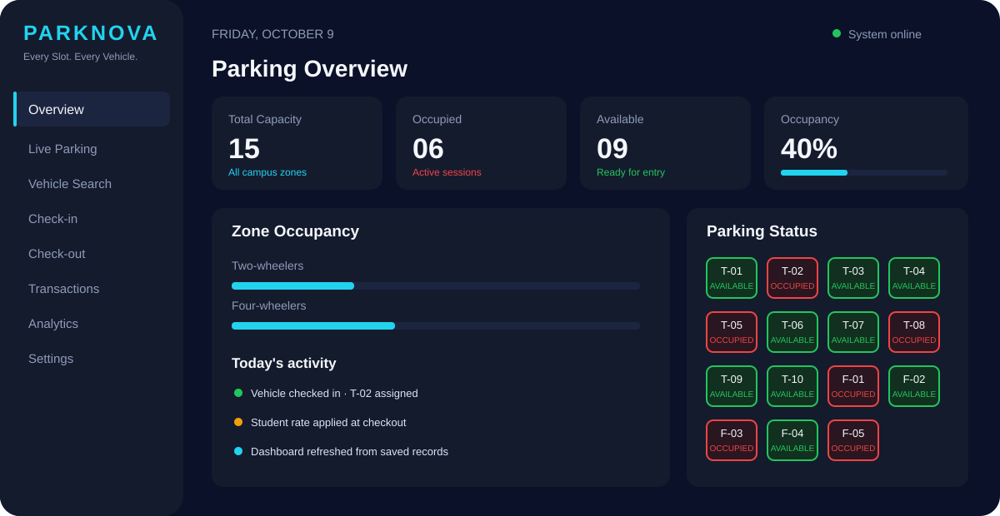
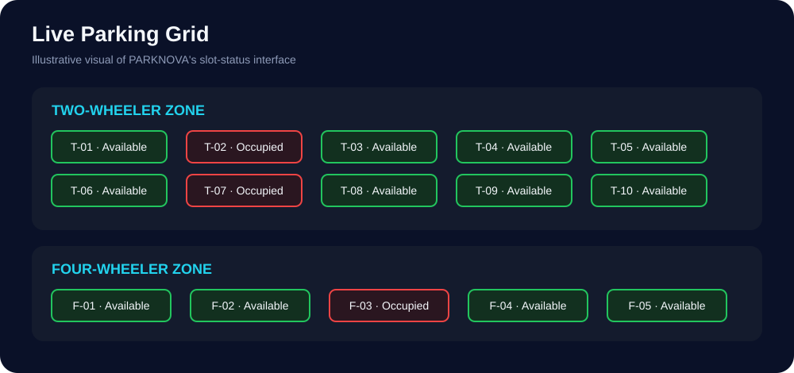
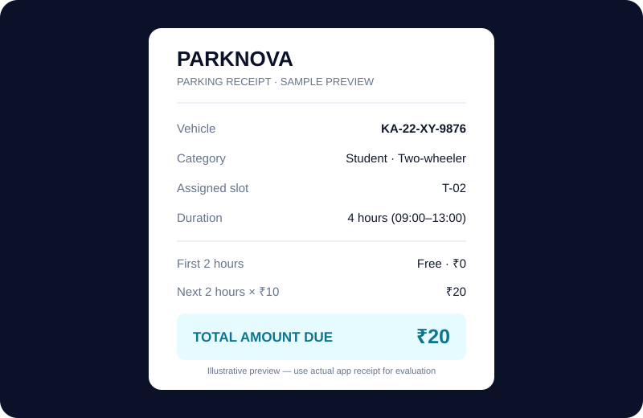
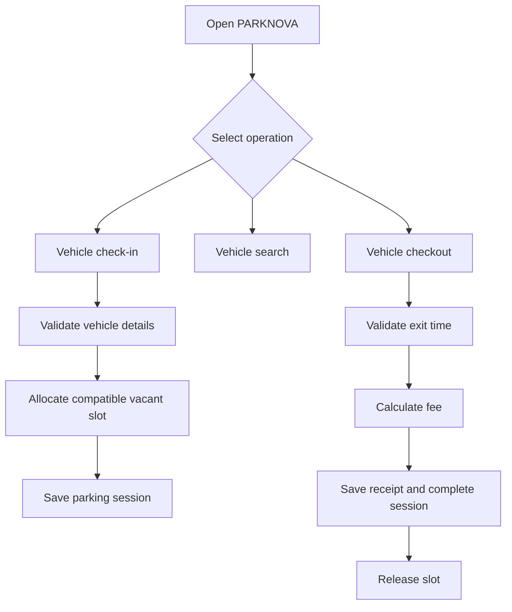

# 🚗 PARKNOVA
### Smart Campus Parking & Vehicle Intelligence System

**Every Slot. Every Vehicle. Under Control.**

A campus parking management system designed for the AMBIT Codethon 2026.


</div>

---

## 🌌 Project Preview

### Command Centre


### Live Parking Grid


### Sample Parking Receipt


> These are illustrative visuals. Use the running application for the official live demonstration.

## ✨ About PARKNOVA

PARKNOVA is a campus parking management system that helps operators manage vehicle entry and exit, assign compatible parking slots, find vehicles, calculate parking fees, issue receipts, and monitor parking occupancy.

## 🚀 Key Features

- **Dashboard:** capacity, occupied spaces, available spaces, and occupancy.
- **Visual parking grid:** separate two-wheeler and four-wheeler zones.
- **Vehicle check-in:** allocate a compatible vacant slot.
- **Vehicle search:** find vehicles by registration number or slot ID.
- **Checkout and receipts:** calculate fees and display an itemized receipt.
- **Validation:** prevent duplicate active vehicle registrations and invalid exit times.
- **Persistent storage:** save parking sessions in SQLite.
- **Activity history and analytics:** summarize operations using stored records.
- **CSV export and demo mode:** support reporting and demonstrations.

## 🅿️ Parking Capacity

| Vehicle Type | Slot IDs | Capacity |
|---|---|---:|
| Two-wheelers | `T-01` to `T-10` | 10 |
| Four-wheelers | `F-01` to `F-05` | 5 |
| **Total** | | **15** |

## 💰 Parking Fee Structure

| Owner Category | Two-wheeler | Four-wheeler |
|---|---|---|
| Staff | Free | Free |
| Student | First 2 hours free, then ₹10/hour | First 2 hours free, then ₹20/hour |
| Visitor | ₹20/hour | ₹40/hour |

### Example

A student parks a two-wheeler from 09:00 to 13:00:

- Total duration: 4 hours
- First 2 hours: free
- Chargeable duration: 2 hours
- Rate: ₹10 per chargeable hour
- **Total fee: ₹20**

The current hour-based model rejects an exit hour earlier than the entry hour and does not support overnight parking.

## 🧭 How It Works



## 🧰 Technology Stack

- Python
- Flask
- HTML, CSS, and JavaScript
- SQLite
- pytest

## ⚙️ Setup and Installation

### 1. Clone the repository

```bash
git clone https://github.com/YOUR-USERNAME/parknova.git
cd parknova
```

Replace `YOUR-USERNAME` with your GitHub username and adjust the repository name if needed.

### 2. Create a virtual environment

**Windows**
```bash
py -m venv .venv
.venv\Scripts\activate
```

**macOS / Linux**
```bash
python3 -m venv .venv
source .venv/bin/activate
```

### 3. Install dependencies

```bash
pip install -r requirements.txt
```

### 4. Run the application

```bash
python app.py
```

Open **http://127.0.0.1:5000** in your browser.

### 5. Run tests

```bash
python -m pytest -q
```

## 🏆 Suggested Judge Demonstration

1. Show the dashboard and the 15 available slots.
2. Check in a student two-wheeler.
3. Check in a staff four-wheeler and demonstrate free parking.
4. Search for a vehicle.
5. Attempt a duplicate check-in to demonstrate validation.
6. Check out the student vehicle after four hours and show the ₹20 receipt.
7. Show the slot becoming available and the dashboard updating.
8. Restart the application to verify persistence.

## 📁 Project Structure

```text
parknova/
├── README.md
├── app.py
├── billing.py
├── service.py
├── requirements.txt
├── templates/
│   └── index.html
├── tests/
│   └── test_parknova.py
└── docs/
    └── images/
        ├── dashboard-preview.svg
        ├── parking-grid-preview.svg
        └── receipt-preview.svg
```

## 🔐 Data Notes

- Validate inputs on the server.
- Use fictional registration numbers in screenshots and demos.
- Do not commit sensitive records, credentials, or a local database containing private data.
- The slot recommendation uses the lowest-numbered compatible vacant slot; it does not calculate physical distance.

## 🚧 Scope and Limitations

The current hour-based model supports same-day parking only. Camera-based number plate recognition, IoT sensors, and online payment processing are not included in this version.

## 👥 Team

**Project:** PARKNOVA — Smart Campus Parking & Vehicle Intelligence System  
**Event:** AMBIT Codethon 2026

Add your team members, institution, repository URL, and demo link here.

---

<div align="center">

**PARKNOVA**  
*Smarter parking. Clearer operations. Better campus mobility.*

</div>
